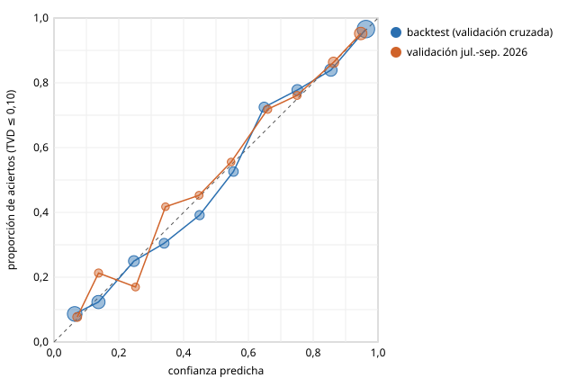

# Fase 10 · Modelo de confianza

> **Actualización del 2026-10-23, tras corregir las escalas 1-10 (D-089).** Puerta **superada** de nuevo con el mismo comando (`reports/fase_10_puerta.md`): Spearman 0,815 en 2.825 casos, ECE 0,029, confianza media total 0,89 y subgrupos 0,64 (Spearman 0,50 en subgrupos y 0,40 entre comunidades). Las tablas de abajo son las de antes de la corrección.


**Estado:** puerta automática superada (G10.1-G10.3). F10 no tiene revisión humana obligatoria (`docs/04`).
**Fecha:** 2026-10-21 · **Decisión:** D-070
**Comando para reproducir** (tras la cadena de `reports/fase_09.md`; el *backtest* tarda unas dos horas):

```
python -c "from sinpop.confidence.run import construir; construir(rehacer_backtest=True)" \
  && python -m sinpop.evaluate.confianza && python -m sinpop.confidence.diagrama \
  && sinpop validate --phase 10
```

## Resumen

- **Qué es la confianza:** la probabilidad de que la predicción tenga un error (TVD frente al CIS) ≤ 0,10. Se da para el total y para cada subgrupo, y junto a ella va el error predicho.
- ***Backtest*:** 384 preguntas de julio de 2025 a junio de 2026, cada una predicha solo con el banco anterior a su fecha. Son 9.511 casos entre total y subgrupos.
- **Modelo:** *gradient boosting* con restricciones de monotonía y calibración isotónica por validación cruzada agrupada por pregunta.
- **Validación** (barómetros de julio y septiembre de 2026, posteriores al corte): sin recalibrar, el modelo ya está calibrado. Recalibrar con solo dos barómetros lo empeora, así que no se recalibra.
- **Salidas:** las predicciones de `predict/salida.py` usan ya esta confianza en lugar de la provisional de F9.

## Puerta de salida

| ID | Resultado | Valor |
| --- | --- | --- |
| G10.1 V-CONF-CORR | ✅ | Spearman(confianza, −error) = 0,76 en 2.588 casos (umbral ≥ 0,40) |
| G10.2 V-CONF-ECE | ✅ | ECE = 0,018 (umbral ≤ 0,05) |
| G10.3 Tamaño del territorio y del subgrupo | ✅ | Confianza media: total 0,84, subgrupos 0,68. Spearman entre confianza y datos del subgrupo: 0,46 en subgrupos y 0,34 entre comunidades |

Puerta generada en `reports/fase_10_puerta.md`. Los valores son los de la variante publicada (`publicada` en `reports/fase_10_validacion.json`).

El detalle por caso de `reports/fase_10/validacion_confianza.csv` corresponde a la variante recalibrada de forma cruzada (la de la comparación de variantes), no a la publicada.

## Diagrama de calibración



- Eje x: confianza predicha; eje y: proporción de casos con TVD ≤ 0,10. El área de cada punto es proporcional a los casos.
- Las dos series están cerca de la diagonal.

| Confianza | Casos (validación) | Confianza media | Aciertos |
| --- | --- | --- | --- |
| 0,0-0,1 | 233 | 0,07 | 0,08 |
| 0,1-0,2 | 155 | 0,14 | 0,21 |
| 0,2-0,3 | 112 | 0,25 | 0,17 |
| 0,3-0,4 | 91 | 0,34 | 0,42 |
| 0,4-0,5 | 106 | 0,45 | 0,45 |
| 0,5-0,6 | 99 | 0,55 | 0,56 |
| 0,6-0,7 | 142 | 0,66 | 0,72 |
| 0,7-0,8 | 134 | 0,75 | 0,76 |
| 0,8-0,9 | 490 | 0,86 | 0,86 |
| 0,9-1,0 | 1.026 | 0,95 | 0,95 |

## Comparación de variantes

| Variante | Dónde | Spearman | ECE |
| --- | --- | --- | --- |
| Modelo elegido | *backtest*, validación cruzada | 0,77 | 0,018 |
| Regresión logística (descartada) | *backtest*, validación cruzada | 0,73 | 0,055 |
| Modelo elegido, sin recalibrar (**publicada**) | validación | 0,76 | 0,018 |
| Recalibrado con un barómetro, evaluado en el otro | validación | 0,76 | 0,047 |

## Qué señales pesan

Importancia por permutación (caída del Spearman en el *backtest*):

| Señal | Caída |
| --- | --- |
| Número de opciones | 0,27 |
| Datos del subgrupo | 0,09 |
| Antigüedad de la análoga más reciente | 0,07 |
| Anchura del IC80 | 0,06 |
| Similitud con el banco | 0,05 |

Lectura:

- Con más opciones hay más masa que repartir mal, así que la TVD es mayor.
- Los subgrupos pequeños y las comunidades con pocos encuestados tienen menos confianza.
- En el *backtest* aciertan el 67 % de los totales y el 49 % de las filas de comunidad.

## Limitaciones

- La confianza describe el componente estadístico. Si se incorpora un modelo de lenguaje, el *backtest* debe repetirse con él.
- **Calibración de los intervalos de F9:** se aprendió con preguntas de abril a junio de 2026, que caen dentro del periodo del *backtest*. Afecta solo a la señal de anchura del intervalo; en la ventana de validación no hay solapamiento y los resultados se mantienen.
- **La confianza mide el acierto frente a lo que mide el CIS**, no frente a la opinión real de la población: es lo único observable.
